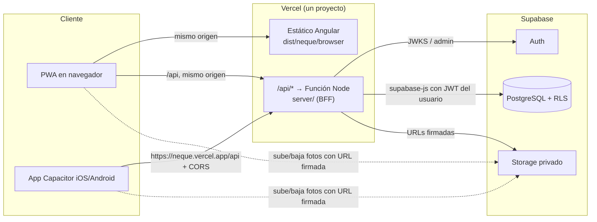

# 01 — Arquitectura monolítica

**Estado:** propuesta (2026-11-02). Reemplaza §5.1–5.2 del PRD («BFF en repo aparte»)
cuando se apruebe.
**Origen:** [auditoría integral](../auditoria/2026-11-02-auditoria-integral.md).

---

## 1. Decisión

Un solo repositorio y un solo proyecto Vercel con tres piezas:

| Pieza    | Qué es                                   | Dónde corre                                   |
| -------- | ---------------------------------------- | --------------------------------------------- |
| Frontend | La app Angular actual, sin reestructurar | CDN de Vercel (estático) y Capacitor (nativo) |
| BFF      | API TypeScript hexagonal en `server/`    | Vercel Functions (Node.js), una sola función  |
| Datos    | PostgreSQL, Auth y Storage               | Supabase Cloud                                |



**Por qué monolito:** el PRD marca el BFF como riesgo R1 (camino crítico) y el autor es
una sola persona. Un repo elimina versionar el contrato entre dos repos, permite que el
BFF reutilice los modelos del dominio del front y deja un único pipeline y un único
deploy (Preview por PR incluido).

**Qué NO cambia:** la app Angular sigue organizada en `domain / application /
infrastructure / ui`. Conectarla es agregar adapters HTTP en `infrastructure/` y cambiar
los `provide*MockData()` por `provide*HttpAdapters()`.

---

## 2. Arquitectura actual (verificada)

| Pregunta                                                | Respuesta                                                                              |
| ------------------------------------------------------- | -------------------------------------------------------------------------------------- |
| ¿Cómo está el frontend?                                 | Hexagonal por `{capa}/{feature}`, 14 puertos con `InjectionToken`, facades con signals |
| ¿Existe backend?                                        | No                                                                                     |
| ¿Qué servicios consume?                                 | Ninguno real. Solo `@capacitor/share` y `screen-orientation`                           |
| ¿Integraciones externas?                                | Ninguna activa. `flowApiUrl` y claves Supabase vacías, sin consumidores                |
| ¿Lógica de negocio en el front que debe ir al servidor? | Ver §4                                                                                 |

---

## 3. Estructura de carpetas objetivo

```
ui-any-neque-mobile-app/
├── api/
│   └── [[...route]].ts          ← único entrypoint de Vercel; solo importa server/http/app
├── server/                      ← BFF (nuevo)
│   ├── domain/                  reglas que solo existen en servidor + re-export de modelos
│   │   ├── shared/              AppError del servidor, Clock, ids
│   │   ├── auth/  students/  trainers/  routines/  workouts/
│   │   ├── schedule/  notifications/  progress/
│   │   └── */port/*.ts          puertos de salida (repositorios, storage, mailer) — interfaces TS puras
│   ├── application/             casos de uso: 1 archivo por caso (`assign-routine.ts`, `accept-invitation.ts`)
│   ├── infrastructure/
│   │   ├── supabase/            clientes (usuario / admin), repositorios, mapeo snake_case ↔ camelCase
│   │   ├── storage/             URLs firmadas
│   │   └── auth/                verificación JWT (JWKS), admin de usuarios
│   ├── http/
│   │   ├── app.ts               composición: middlewares + routers
│   │   ├── middleware/          auth, cors, request-id, errores, rate-limit
│   │   ├── routes/              un router por feature
│   │   └── schemas/             validación de entrada (zod) por endpoint
│   ├── config/env.ts            lectura y validación de variables (falla al arrancar si falta una)
│   └── test/                    unit (casos de uso con repos en memoria) + integración (Supabase local)
├── src/                         ← Angular (existente)
│   ├── app/domain/              SIN CAMBIOS salvo DomainErrorCode (§5)
│   ├── app/application/         SIN CAMBIOS salvo 3 excepciones (§5)
│   ├── app/infrastructure/
│   │   ├── http/                NUEVO: api-client, interceptor auth, mapeo de errores
│   │   ├── */ *.http-adapter.ts NUEVO: un adapter HTTP por puerto
│   │   └── */ *.mock-adapter.ts se conservan para tests y modo demo
│   └── environments/            + apiBaseUrl; − supabaseUrl/AnonKey/flowApiUrl
├── supabase/                    ← NUEVO (CLI de Supabase)
│   ├── config.toml
│   ├── migrations/              SQL versionado, nunca editado una vez aplicado
│   ├── seed.sql                 datos de desarrollo (nunca en prod)
│   └── tests/                   pgTAP: RLS y restricciones
├── tsconfig.json                + paths @domain/*, @server/*
├── tsconfig.server.json         NUEVO: target node, sin DOM, include server/ api/
└── vercel.json                  rewrites que respetan /api (ver 04)
```

### 3.1 Regla de dependencias del BFF

| Capa                    | Puede importar                                              | Nunca                                                |
| ----------------------- | ----------------------------------------------------------- | ---------------------------------------------------- |
| `server/domain`         | `server/domain`, modelos puros de `src/app/domain/**/model` | application, infrastructure, http, supabase-js, hono |
| `server/application`    | `server/domain`                                             | infrastructure, http                                 |
| `server/infrastructure` | `server/domain`                                             | application, http                                    |
| `server/http`           | todas (es la raíz de composición)                           | —                                                    |
| `api/`                  | `server/http/app`                                           | nada más                                             |

Se hace cumplir con `eslint-plugin-import` (`no-restricted-paths`), igual que en el front.

### 3.2 Código compartido front ↔ BFF

Los modelos de `src/app/domain/**/model/*.ts` **no importan Angular** (verificado).
El BFF los importa con el alias `@domain/*` → `src/app/domain/*`. Se comparten:

- Tipos del contrato: `Student`, `Routine`, `WorkoutSession`, `WorkoutSetInput`, `AppNotification`, …
- Reglas puras: `withDerivedStatus`, `isResolved`, `studentRisk`, `adherencePercent`,
  `goalsMatch`, `isAnamnesisUsable`, `hasClinicalFlags`, `INVITATION_TTL_HOURS`.

Los **puertos no** se comparten (dependen de `InjectionToken` y `rxjs`).

**Regla:** si un modelo empieza a necesitar algo de Angular, se rompe el build del BFF.
Agregar un test de CI: `tsc -p tsconfig.server.json --noEmit` en el job `typecheck`.

---

## 4. Responsabilidades que se mudan al BFF

| Hoy en el front (mock)                                     | Debe vivir en                | Por qué                                                   |
| ---------------------------------------------------------- | ---------------------------- | --------------------------------------------------------- |
| Validar credenciales, bloqueo por 5 intentos               | BFF + tabla `login_attempts` | Las funciones serverless no comparten memoria             |
| Vigencia de 48 h, un solo uso, revocar al reemitir         | BFF + `invitations`          | Seguridad                                                 |
| Unicidad del correo del alumno                             | BD (índice único)            | Concurrencia                                              |
| Un alumno, una rutina (archivar la anterior)               | Función SQL transaccional    | Índice único parcial                                      |
| Generar `workoutSessions` desde la asignación              | BFF (materialización)        | Hoy solo existe `buildWorkoutSeed()`                      |
| `takenAt` de la evaluación                                 | BD (`now()`)                 | El puerto ya lo exige: "falsificable" en cliente          |
| Alertas al entrenador (dolor, riesgo, invitación aceptada) | BFF al registrar el evento   | Hoy se derivan en `trainer-notifications.mock-adapter.ts` |
| Límite freemium (HU-12.4)                                  | BFF + BD                     | Decisión 2 del plan Épica 12                              |
| `trainerId` / `studentId` del usuario                      | Del JWT, nunca del body      | El cliente puede mentir                                   |

Se quedan en el front: formateo, cálculo de gráficos (`chart-math.ts`), IMC para mostrar,
navegación por `targetType`, validaciones de UX (se **repiten** en el BFF).

---

## 5. Cambios inevitables fuera de `infrastructure/` (aceptados)

El PRD promete que conectar el backend «solo reemplaza infraestructura». Hay cuatro
excepciones justificadas; se documentan para que no se lean como deuda escondida:

| #   | Cambio                                                                                            | Capa                      | Motivo                                                         |
| --- | ------------------------------------------------------------------------------------------------- | ------------------------- | -------------------------------------------------------------- |
| 1   | `DomainErrorCode` + `forbidden`, `validation`, `plan_limit`, `offline`                            | domain                    | El BFF los produce; hoy se mapearían a `unknown`               |
| 2   | `TrainerHomeFacade` y `TrainerProfileFacade` consumen un puerto agregado `TRAINER_DASHBOARD_PORT` | domain + application      | N+1: 4 peticiones por alumno activo                            |
| 3   | `SchedulePort.create/update` y UI del entrenador para agendar                                     | domain + application + ui | Hoy nadie puede crear una cita                                 |
| 4   | `ProgressPhoto.url` sigue siendo `url`; la subida en dos pasos queda **dentro** del adapter HTTP  | —                         | No cambia nada fuera de infra (se lista para dejar constancia) |

---

## 6. Alternativas descartadas

| Alternativa                                             | Por qué no                                                                                                                   |
| ------------------------------------------------------- | ---------------------------------------------------------------------------------------------------------------------------- |
| El front habla directo con Supabase (supabase-js + RLS) | Descartada ya el 2026-09-17 (Épica 1). Además: lógica de negocio (freemium, materialización, alertas) quedaría en el cliente |
| BFF en repo aparte                                      | Es lo que el cambio de enfoque elimina                                                                                       |
| Migrar el front a Next.js/Analog para tener SSR + API   | Reescritura; viola "reutilizar lo existente"                                                                                 |
| NestJS tradicional (`app.listen`) en Vercel             | No hay proceso persistente en Vercel. Ver alternativa adaptada en `02-bff-directrices.md` §2                                 |
