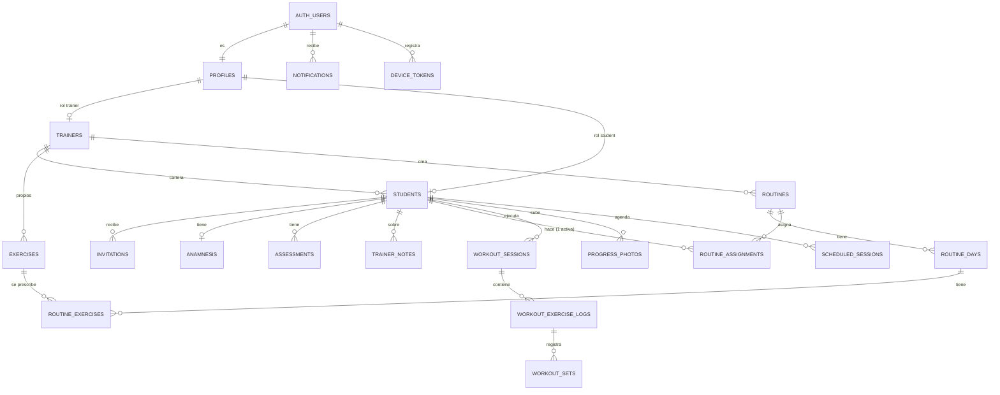

# 03 — Directrices de base de datos (Supabase)

**Estado:** modelo **propuesto** (2026-11-02). **No se ha creado nada en Supabase.**
Este documento es el paso previo exigido: se aprueba el modelo, y recién entonces se
escribe la primera migración.

Reemplaza a [`../modelo-datos.md`](../modelo-datos.md) v2, que quedó desfasado respecto
del código (ver §1). Las 19 decisiones de aquel documento se conservan salvo las que se
listan como cambiadas.

---

## 1. Qué cambia respecto de `modelo-datos.md` v2

| #   | Cambio                                                                                                       | Motivo / evidencia                                                                                                                                                     |
| --- | ------------------------------------------------------------------------------------------------------------ | ---------------------------------------------------------------------------------------------------------------------------------------------------------------------- |
| C1  | **snake_case** en tablas y columnas; la API sigue en camelCase **[DECISIÓN]**                                | En Postgres el camelCase obliga a comillas en todo SQL, política RLS y función. Con un BFF de por medio el mapeo es un archivo (`mappers/`). Revierte la convención v2 |
| C2  | `users` → `auth.users` (Supabase) + `public.profiles`                                                        | Supabase Auth. Desaparecen `passwordHash`, `otpCodes`, `authSessions`                                                                                                  |
| C3  | `routines` pierde `studentId`, `startDate`, `endDate`, `status`; nace `routine_assignments`                  | T-13.3.1: `Routine` es plantilla con `assignments[]`                                                                                                                   |
| C4  | `routine_exercises` + `load`, `measure`, `duration_seconds`; `exercises` + `default_load`, `default_measure` | T-13.5.3, `prescription.ts`                                                                                                                                            |
| C5  | `workout_exercise_logs` + `load`, `measure`, `duration_seconds`, `skipped`, `skip_reason`                    | T-13.5.4, `workout-session.model.ts`                                                                                                                                   |
| C6  | `workout_sets` + `duration_seconds`, `skipped`, `skip_reason`, `client_op_id`                                | `workout-set.model.ts`; decisión 10 del plan Épica 12                                                                                                                  |
| C7  | `notification_kind` + `alert`, `invitation`; `target_type` + `student`                                       | `notification.model.ts`                                                                                                                                                |
| C8  | `trainers` + `plan`                                                                                          | HU-12.4                                                                                                                                                                |
| C9  | Tablas nuevas: `trainer_notes`, `device_tokens`, `login_attempts`                                            | HU-12.5, HU-12.9, rate limit sin memoria                                                                                                                               |
| C10 | `invitations` y `password_reset_tickets` guardan **hash** del token                                          | Un volcado de la BD no debe permitir aceptar invitaciones                                                                                                              |
| C11 | `workout_sessions.scheduled_date date` + único `(student_id, routine_day_id, scheduled_date)`                | Materialización idempotente (02 §6)                                                                                                                                    |
| C12 | `avatar_url` → `avatar_path` (clave en bucket)                                                               | Igual que las fotos: el BFF firma                                                                                                                                      |

---

## 2. Proyectos y configuración

| Proyecto                         | Uso                                        | Región                  |
| -------------------------------- | ------------------------------------------ | ----------------------- |
| `neque-dev`                      | Desarrollo compartido + Previews de Vercel | `sa-east-1` (São Paulo) |
| `neque-prod`                     | Producción                                 | `sa-east-1`             |
| Local (`supabase start`, Docker) | Cada desarrollador y CI                    | —                       |

Configuración obligatoria en cada proyecto:

- **Auth → JWT Signing Keys:** clave asimétrica **RS256** (PRD §7). Revocar la secreta
  HS256 heredada una vez migrado.
- **Auth → Providers:** solo Email. **Desactivar "Allow new users to sign up"**
  (invitation-only: todo alta pasa por el admin API del BFF).
- **Auth → Email templates:** plantilla _Reset password_ con `{{ .Token }}` (código de 6
  dígitos), en español.
- **Auth → SMTP:** proveedor propio (Resend, Postmark…). El SMTP por defecto de Supabase
  solo envía a miembros del equipo del proyecto y con un límite muy bajo: **la
  recuperación de contraseña no funciona en producción sin esto**.
- **Auth → OTP expiry:** 600 s (10 min, como decía `otpCodes`).
- **API → Exposed schemas:** solo `public`. El esquema `private` (funciones auxiliares)
  no se expone.
- Revocar a `anon` todo acceso a tablas: el front no usa PostgREST.

---

## 3. Enumeraciones

```sql
create type public.user_role         as enum ('trainer', 'student');
create type public.student_status    as enum ('active', 'suspended');
create type public.trainer_plan      as enum ('free', 'pro');
create type public.invitation_status as enum ('pending', 'accepted', 'expired', 'revoked');
create type public.muscle_group      as enum ('chest','back','legs','shoulders','arms','core','cardio','fullbody');
create type public.exercise_load     as enum ('weight', 'bodyweight', 'weighted_bodyweight');
create type public.exercise_measure  as enum ('reps', 'time');
create type public.workout_status    as enum ('scheduled', 'in_progress', 'completed', 'skipped');
create type public.skip_reason       as enum ('equipment_busy', 'pain', 'no_time', 'other');
create type public.photo_angle       as enum ('front', 'side', 'back');
create type public.session_kind      as enum ('training', 'assessment', 'checkin');
create type public.schedule_status   as enum ('confirmed', 'pending', 'cancelled');
create type public.cancel_reason     as enum ('illness', 'travel', 'injury', 'rescheduled', 'other');
create type public.notification_kind as enum ('routine', 'session', 'message', 'system', 'alert', 'invitation');
create type public.target_type       as enum ('routine', 'session', 'assessment', 'photo', 'student');
create type public.device_platform   as enum ('ios', 'android');
```

Los **valores** son exactamente los del front (viajan por el cable sin traducir).

---

## 4. Tablas (21)

Columnas comunes a todas, no repetidas abajo:
`created_at timestamptz not null default now()`,
`updated_at timestamptz not null default now()` (trigger `private.set_updated_at`),
`deleted_at timestamptz null` (borrado lógico) — salvo en `login_attempts`,
`password_reset_tickets` y `device_tokens`, que se borran de verdad.

PK `id uuid primary key default gen_random_uuid()` salvo indicación.

### 4.1 Identidad

| Tabla                    | Columnas                                                                                                                                                                                                                                                                                                     | Restricciones                                                                  |
| ------------------------ | ------------------------------------------------------------------------------------------------------------------------------------------------------------------------------------------------------------------------------------------------------------------------------------------------------------ | ------------------------------------------------------------------------------ |
| `profiles`               | `id uuid PK → auth.users(id) on delete cascade`, `role user_role not null`, `display_name text not null`, `avatar_path text`                                                                                                                                                                                 | 1:1 con `auth.users`. El correo **no** se duplica: vive en `auth.users.email`  |
| `trainers`               | `user_id uuid not null unique → profiles(id)`, `first_name`, `last_name text not null`, `phone`, `specialty`, `bio text`, `certifications jsonb not null default '[]'`, `plan trainer_plan not null default 'free'`, `joined_at timestamptz not null default now()`                                          | `check (jsonb_typeof(certifications) = 'array')`                               |
| `students`               | `user_id uuid not null unique → profiles(id)`, `trainer_id uuid not null → trainers(id)`, `first_name`, `last_name text not null`, `phone text`, `status student_status not null default 'active'`, `birth_date date`, `height_cm numeric(5,2)`, `goal text`, `joined_at timestamptz not null default now()` | `check (height_cm between 50 and 260)`; índice `(trainer_id, status)`          |
| `invitations`            | `token_hash text PK`, `student_id uuid not null → students(id)`, `expires_at timestamptz not null`, `status invitation_status not null default 'pending'`, `accepted_at`, `revoked_at timestamptz`                                                                                                           | Único parcial `(student_id) where status = 'pending'` (una vigente por alumno) |
| `password_reset_tickets` | `token_hash text PK`, `user_id uuid not null → auth.users(id) on delete cascade`, `expires_at timestamptz not null`, `used_at timestamptz`                                                                                                                                                                   | 15 min                                                                         |
| `login_attempts`         | `key text PK` (email normalizado), `count smallint not null default 0`, `locked_until timestamptz`, `updated_at`                                                                                                                                                                                             | Sin RLS de lectura: solo el BFF (clave secreta)                                |

### 4.2 Ficha del alumno

| Tabla           | Columnas                                                                                                                                                                                                                                                                                                                 | Restricciones                                                                                                     |
| --------------- | ------------------------------------------------------------------------------------------------------------------------------------------------------------------------------------------------------------------------------------------------------------------------------------------------------------------------ | ----------------------------------------------------------------------------------------------------------------- |
| `anamnesis`     | `student_id uuid not null unique → students(id)`, `medical_history`, `previous_injuries`, `surgeries`, `medications`, `allergies`, `previous_activity text`, `declared_goal text not null`, `weekly_availability jsonb not null`, `emergency_contact_name`, `emergency_contact_phone`, `emergency_contact_relation text` | `check (jsonb_typeof(weekly_availability) = 'array' and jsonb_array_length(weekly_availability) between 1 and 7)` |
| `assessments`   | `student_id → students`, `trainer_id → trainers`, `taken_at timestamptz not null default now()`, `weight_kg numeric(5,2) not null`, `height_cm numeric(5,2) not null`, `body_fat_pct numeric(4,1)`, `muscle_mass_kg numeric(5,2)`, `chest_cm`, `waist_cm`, `hip_cm`, `arm_cm`, `thigh_cm numeric(5,2)`, `notes text`     | Índice `(student_id, taken_at desc)`; checks de rango (peso 20–400, grasa 2–70)                                   |
| `trainer_notes` | `student_id → students`, `trainer_id → trainers`, `body text not null`                                                                                                                                                                                                                                                   | **Nunca** legible por el alumno (RLS). Índice `(student_id, created_at desc)`                                     |

### 4.3 Rutinas

| Tabla                 | Columnas                                                                                                                                                                                                                                                                                                      | Restricciones                                                                                                                                                                  |
| --------------------- | ------------------------------------------------------------------------------------------------------------------------------------------------------------------------------------------------------------------------------------------------------------------------------------------------------------- | ------------------------------------------------------------------------------------------------------------------------------------------------------------------------------ |
| `exercises`           | `name text not null`, `muscle_group muscle_group not null`, `equipment text`, `thumbnail_url text`, `instructions jsonb not null default '[]'`, `owner_trainer_id uuid → trainers` (null = catálogo público), `default_load exercise_load`, `default_measure exercise_measure`                                | Índice `(owner_trainer_id)`                                                                                                                                                    |
| `routines`            | `trainer_id uuid not null → trainers`, `name text not null`, `goal text not null`                                                                                                                                                                                                                             | Índice `(trainer_id) where deleted_at is null`                                                                                                                                 |
| `routine_days`        | `routine_id → routines on delete cascade`, `weekday smallint not null check (weekday between 1 and 7)`, `title text not null`, `focus muscle_group not null`, `estimated_minutes integer not null check (> 0)`                                                                                                | Único `(routine_id, weekday)`                                                                                                                                                  |
| `routine_exercises`   | `routine_day_id → routine_days on delete cascade`, `exercise_id → exercises`, `name text not null` (foto), `position integer not null`, `sets`, `reps`, `rest_seconds integer not null`, `weight_kg numeric(6,2)`, `notes text`, `load exercise_load`, `measure exercise_measure`, `duration_seconds integer` | Único `(routine_day_id, position)` (`order` es palabra reservada: se renombra y el mapper lo expone como `order`); `check (measure <> 'time' or duration_seconds is not null)` |
| `routine_assignments` | `routine_id → routines`, `student_id → students`, `start_date date not null`, `end_date date`, `ended_at timestamptz`                                                                                                                                                                                         | **Único parcial `(student_id) where ended_at is null and deleted_at is null`** → un alumno, una rutina. `check (end_date is null or end_date >= start_date)`                   |

Al leer, `Routine.assignments` = filas de `routine_assignments` con `ended_at is null`.

### 4.4 Ejecución

| Tabla                   | Columnas                                                                                                                                                                                                                                                                                                                                                                                                        | Restricciones                                                                                        |
| ----------------------- | --------------------------------------------------------------------------------------------------------------------------------------------------------------------------------------------------------------------------------------------------------------------------------------------------------------------------------------------------------------------------------------------------------------- | ---------------------------------------------------------------------------------------------------- |
| `workout_sessions`      | `student_id → students`, `routine_id → routines`, `routine_day_id → routine_days`, `title text not null` (foto), `scheduled_for timestamptz not null`, `scheduled_date date not null`, `started_at`, `completed_at timestamptz`, `status workout_status not null default 'scheduled'`, `duration_minutes integer`, `estimated_minutes integer not null`, `completion_note text`                                 | **Único `(student_id, routine_day_id, scheduled_date)`**; índice `(student_id, scheduled_for)`       |
| `workout_exercise_logs` | `workout_session_id → workout_sessions on delete cascade`, `routine_exercise_id → routine_exercises`, `exercise_id → exercises`, `name`, `target_sets`, `target_reps`, `rest_seconds`, `weight_kg`, `load`, `measure`, `duration_seconds` (todas foto), `completed_sets integer not null default 0`, `done boolean not null default false`, `skipped boolean not null default false`, `skip_reason skip_reason` | Único `(workout_session_id, routine_exercise_id)`                                                    |
| `workout_sets`          | `workout_exercise_log_id → workout_exercise_logs on delete cascade`, `set_number smallint not null`, `reps integer`, `weight_kg numeric(6,2)`, `duration_seconds integer`, `skipped boolean not null default false`, `skip_reason skip_reason`, `completed_at timestamptz not null default now()`, `client_op_id uuid`                                                                                          | Único `(workout_exercise_log_id, set_number)`; único `(client_op_id) where client_op_id is not null` |

> `routine_exercises` y `routine_days` **no** se borran físicamente si hay sesiones que
> los referencian: `save_routine` marca `deleted_at` en los que desaparecen y crea los
> nuevos. Por eso las FK de `workout_exercise_logs` no llevan `cascade`.

### 4.5 Progreso, agenda, notificaciones

| Tabla                | Columnas                                                                                                                                                                                                                                                                                                                                                                                       | Restricciones                                                                                                                                                                                                        |
| -------------------- | ---------------------------------------------------------------------------------------------------------------------------------------------------------------------------------------------------------------------------------------------------------------------------------------------------------------------------------------------------------------------------------------------- | -------------------------------------------------------------------------------------------------------------------------------------------------------------------------------------------------------------------- | --- | ------ |
| `progress_photos`    | `student_id → students`, `taken_at timestamptz not null`, `storage_path text not null`, `angle photo_angle not null`, `weight_kg numeric(5,2)`, `note text`                                                                                                                                                                                                                                    | `check (storage_path like student_id::text                                                                                                                                                                           |     | '/%')` |
| `scheduled_sessions` | `student_id → students`, `trainer_id → trainers`, `title text not null`, `starts_at`, `ends_at timestamptz not null`, `location text`, `kind session_kind not null`, `status schedule_status not null default 'pending'`, `workout_session_id → workout_sessions`, `cancellation_reason cancel_reason`, `cancellation_note text`, `cancelled_at timestamptz`, `cancelled_by uuid → auth.users` | `check (ends_at > starts_at)`; `check (status <> 'cancelled' or cancellation_reason is not null)`; `check (cancellation_reason <> 'other' or length(trim(cancellation_note)) > 0)`; índice `(student_id, starts_at)` |
| `notifications`      | `user_id uuid not null → auth.users on delete cascade`, `kind notification_kind not null`, `title`, `body text not null`, `read_at timestamptz`, `target_type target_type`, `target_id uuid`                                                                                                                                                                                                   | Índice parcial `(user_id) where read_at is null`; `check ((target_type is null) = (target_id is null))`                                                                                                              |
| `device_tokens`      | `token text PK`, `user_id → auth.users on delete cascade`, `platform device_platform not null`, `last_seen_at timestamptz not null default now()`                                                                                                                                                                                                                                              | HU-12.9                                                                                                                                                                                                              |

---

## 5. Diagrama ER (resumen)



---

## 6. Row Level Security

### 6.1 Reglas generales

1. `alter table … enable row level security` en **las 21 tablas**, en la misma
   migración que las crea.
2. Políticas solo para el rol `authenticated`. `anon` sin políticas y sin `grant`.
3. Identidad desde el JWT, envuelta en `(select …)` para que Postgres la evalúe una vez
   por consulta y no por fila.
4. Todas las columnas usadas en políticas están indexadas (`trainer_id`, `student_id`,
   `user_id`).
5. El BFF usa el cliente **con el JWT del usuario** para todo lo que no sea admin, así
   que RLS aplica de verdad (CA7 del PRD), no solo en papel.

### 6.2 Funciones auxiliares (esquema `private`, no expuesto)

```sql
create schema private;
grant usage on schema private to authenticated;

create function private.role() returns text
  language sql stable as $$ select coalesce(auth.jwt() -> 'app_metadata' ->> 'role', '') $$;

create function private.profile_id() returns uuid
  language sql stable as $$ select nullif(auth.jwt() -> 'app_metadata' ->> 'profile_id', '')::uuid $$;

-- ¿El usuario actual es el entrenador de este alumno?
create function private.trains(p_student uuid) returns boolean
  language sql stable security definer set search_path = '' as $$
  select private.role() = 'trainer' and exists (
    select 1 from public.students s
    where s.id = p_student and s.trainer_id = private.profile_id()
  ) $$;

-- ¿El usuario actual es este alumno?
create function private.is_student(p_student uuid) returns boolean
  language sql stable as $$ select private.role() = 'student' and private.profile_id() = p_student $$;
```

### 6.3 Matriz de acceso

| Tabla                                                       | Entrenador                                                         | Alumno                                                                               |
| ----------------------------------------------------------- | ------------------------------------------------------------------ | ------------------------------------------------------------------------------------ |
| `profiles`                                                  | Propio + los de sus alumnos (select)                               | Propio + el de su entrenador (select); update propio (`display_name`, `avatar_path`) |
| `trainers`                                                  | select/update propio                                               | select del suyo                                                                      |
| `students`                                                  | select/insert/update donde `trainer_id = profile_id()`             | select/update propio                                                                 |
| `invitations`                                               | todo sobre sus alumnos                                             | — (la resolución pública la hace el BFF con clave secreta)                           |
| `anamnesis`                                                 | todo, `trains(student_id)`                                         | **ninguno**                                                                          |
| `assessments`                                               | todo, `trains(student_id)`                                         | select propio                                                                        |
| `trainer_notes`                                             | todo, `trains(student_id) and trainer_id = profile_id()`           | **ninguno**                                                                          |
| `exercises`                                                 | select `owner_trainer_id is null or = profile_id()`; insert propio | select si está en una rutina que tiene asignada                                      |
| `routines`, `routine_days`, `routine_exercises`             | todo, `trainer_id = profile_id()` (vía JOIN en hijas)              | select si existe asignación activa propia                                            |
| `routine_assignments`                                       | todo sobre sus rutinas **y** sus alumnos                           | select propio                                                                        |
| `workout_sessions`, `workout_exercise_logs`, `workout_sets` | select, `trains(student_id)`                                       | select/update propio; insert de `workout_sets` propio                                |
| `progress_photos`                                           | select, `trains(student_id)`                                       | todo propio                                                                          |
| `scheduled_sessions`                                        | todo, `trainer_id = profile_id()`                                  | select propio; update propio (confirmar/cancelar)                                    |
| `notifications`                                             | select/update `user_id = auth.uid()`                               | ídem                                                                                 |
| `device_tokens`                                             | todo `user_id = auth.uid()`                                        | ídem                                                                                 |
| `login_attempts`, `password_reset_tickets`                  | ninguno                                                            | ninguno                                                                              |

Ejemplo:

```sql
create policy "trainer manages own students' assessments"
  on public.assessments for all to authenticated
  using ((select private.trains(student_id)))
  with check ((select private.trains(student_id)) and trainer_id = (select private.profile_id()));

create policy "student reads own assessments"
  on public.assessments for select to authenticated
  using ((select private.is_student(student_id)));
```

Las restricciones de **columna** (el alumno no cambia su `trainer_id` ni su `status`)
no las expresa RLS: van en el BFF (zod `.strict()`) **y** en un trigger
`before update` que rechaza el cambio si `private.role() = 'student'`.

### 6.4 Pruebas obligatorias (pgTAP, `supabase/tests/`)

- `rls_isolation.test.sql`: con dos entrenadores y un alumno cada uno, para **cada
  tabla**, A no ve, no inserta, no actualiza nada de B → **CA7**.
- `rls_student.test.sql`: el alumno no lee `anamnesis` ni `trainer_notes`; no cambia su
  `trainer_id`/`status`; no ve sesiones de otro alumno.
- `constraints.test.sql`: una rutina activa por alumno, un día por weekday, serie única,
  `client_op_id` único, nota obligatoria con `other`.

---

## 7. Funciones transaccionales (RPC)

Toda escritura multi-fila es una función `plpgsql`, `security invoker` (aplica RLS del
llamador) salvo donde se indique.

| Función                                                                       | Hace                                                                                                                                                         | Notas                                                                                                |
| ----------------------------------------------------------------------------- | ------------------------------------------------------------------------------------------------------------------------------------------------------------ | ---------------------------------------------------------------------------------------------------- |
| `save_routine(p_routine_id uuid null, p_payload jsonb)`                       | Crea/actualiza cabecera + días + ejercicios; marca `deleted_at` en lo que sobra; regenera logs de sesiones futuras sin series                                | Devuelve el id                                                                                       |
| `set_routine_assignments(p_routine_id, p_assignments jsonb)`                  | Cierra (`ended_at = now()`) las asignaciones activas de esos alumnos en **cualquier** rutina, cierra las de esta rutina que ya no vienen, inserta las nuevas | El único parcial falla si se hiciera en dos pasos                                                    |
| `ensure_workout_sessions(p_student_id, p_from date, p_to date)`               | Materializa sesiones + logs desde la asignación activa                                                                                                       | `on conflict do nothing`; idempotente                                                                |
| `log_workout_set(p_session, p_routine_exercise, p_set jsonb, p_client_op_id)` | Upsert de la serie, recalcula `completed_sets`/`done`, pasa a `in_progress`                                                                                  | Duplicado de `client_op_id` = no-op                                                                  |
| `complete_workout(p_session, p_duration, p_note)`                             | Cierra la sesión                                                                                                                                             |                                                                                                      |
| `create_student(p_user_id, p_payload jsonb)`                                  | Inserta `profiles` + `students`; valida freemium                                                                                                             | `security definer` (el perfil aún no existe en el JWT); verifica `private.role() = 'trainer'` dentro |
| `set_student_status(p_student, p_status)`                                     | Suspende/reactiva; reactivar valida freemium                                                                                                                 | `RAISE ... HINT = 'plan_limit'`                                                                      |
| `issue_invitation(p_student, p_token_hash, p_expires_at)`                     | Revoca la pendiente y crea la nueva                                                                                                                          |                                                                                                      |
| `accept_invitation(p_token_hash)`                                             | Valida `pending` + vigente, marca `accepted`, crea notificación `invitation` al entrenador                                                                   | `security definer`, la llama el BFF con clave secreta                                                |
| `trainer_dashboard()`                                                         | Agregado para el Inicio (H-05)                                                                                                                               | Una sola consulta                                                                                    |

---

## 8. Storage

| Bucket            | Público | Límite | MIME                                                  | Ruta                        |
| ----------------- | ------- | ------ | ----------------------------------------------------- | --------------------------- |
| `progress-photos` | **No**  | 5 MB   | `image/jpeg`, `image/png`, `image/webp`, `image/heic` | `{student_id}/{uuid}.{ext}` |
| `avatars`         | No      | 2 MB   | `image/jpeg`, `image/png`, `image/webp`               | `{user_id}/{uuid}.{ext}`    |

- Subida: el BFF crea una **URL de subida firmada** (`createSignedUploadUrl`); el
  cliente sube directo a Storage (las fotos nunca pasan por la función de Vercel, cuyo
  body está limitado a 4,5 MB).
- Lectura: el BFF devuelve **URL firmada de 10 min** en cada respuesta (decisión 9 v2).
- Políticas en `storage.objects` como defensa en profundidad: select si
  `(storage.foldername(name))[1]` es el propio `profile_id` o un alumno que el usuario
  entrena.
- Borrado de foto: objeto eliminado + fila con `deleted_at`.
- El cliente debe redimensionar a 1080 px / calidad 80 antes de subir (HU-12.8).

---

## 9. Migraciones

```
supabase/migrations/
  20261110000000_extensions_and_enums.sql
  20261110000100_identity.sql           profiles, trainers, students, invitations, tickets, login_attempts
  20261110000200_student_record.sql     anamnesis, assessments, trainer_notes
  20261110000300_routines.sql
  20261110000400_workouts.sql
  20261110000500_progress_schedule_notifications.sql
  20261110000600_rls_helpers_and_policies.sql
  20261110000700_rpc.sql
  20261110000800_storage.sql
  20261110000900_reference_exercise_catalog.sql   ← datos de referencia: SÍ van a prod
```

Reglas:

- `supabase migration new <nombre>`; una migración aplicada **nunca** se edita.
- Cada migración que crea una tabla habilita RLS en el mismo archivo.
- Local: `supabase db reset` (aplica migraciones + `seed.sql`) antes de cada PR.
- Tipos: `supabase gen types typescript --local > server/infrastructure/supabase/database.types.ts`
  y un job de CI que falla si el archivo generado difiere del commiteado.
- `neque-dev`: `supabase db push` automático al mergear a `develop`.
- `neque-prod`: `supabase db push` en el workflow de release, con _GitHub Environment_
  `production` y aprobación manual. **Nunca** cambios de esquema desde el panel en prod.
- Migraciones destructivas (drop/rename de columna): en dos releases (expandir →
  contraer).

---

## 10. Seeds

| Dato                                                                                               | Dónde                                                                                  | ¿Prod?                                          |
| -------------------------------------------------------------------------------------------------- | -------------------------------------------------------------------------------------- | ----------------------------------------------- |
| Catálogo público de ejercicios (de `infrastructure/routines/seed/exercises.seed.ts`)               | Migración `reference_exercise_catalog`                                                 | **Sí**                                          |
| Entrenador `kelvin@neque.cl`, alumna `alejandra@neque.cl`, rutinas, evaluaciones, fotos de ejemplo | `supabase/seed.sql` + `supabase/scripts/seed-auth.ts` (crea usuarios con el admin API) | **Nunca**                                       |
| Segundo entrenador con un alumno                                                                   | `seed.sql`                                                                             | No — existe para las pruebas de aislamiento RLS |

Las contraseñas semilla **no** se versionan en claro en el repo: el script las lee de
`SEED_TRAINER_PASSWORD` / `SEED_STUDENT_PASSWORD` del `.env` local.

---

## 11. Respaldo y recuperación

| Medida                 | Detalle                                                                                                                                                              |
| ---------------------- | -------------------------------------------------------------------------------------------------------------------------------------------------------------------- |
| Backups del proveedor  | Dependen del plan (en Free no hay backups diarios descargables; Pro sí). **Verificar el plan vigente** antes del Hito 7                                              |
| Respaldo propio        | Workflow nocturno `supabase db dump --data-only` + `--schema-only` de `neque-prod`, cifrado (`age`/`gpg`) y guardado como artefacto privado con retención de 30 días |
| Storage                | Las fotos no entran en `db dump`: script semanal que copia el bucket                                                                                                 |
| Prueba de restauración | Mensual: restaurar el dump en `neque-dev` y correr los tests pgTAP                                                                                                   |
| Pausa por inactividad  | En Free los proyectos inactivos se pausan: prod en Pro, o ping de `/api/health` diario por cron                                                                      |

---

## 12. Gestión de errores de BD (para el BFF)

| Código Postgres / PostgREST             | Significado            | `DomainErrorCode`          |
| --------------------------------------- | ---------------------- | -------------------------- |
| `23505`                                 | Violación de único     | `conflict`                 |
| `23503`                                 | FK inexistente         | `not_found`                |
| `23514`                                 | `check`                | `validation`               |
| `P0001` + `hint = 'plan_limit'`         | Freemium               | `plan_limit`               |
| `P0001` + `hint = 'invalid_invitation'` | Invitación no válida   | `invalid_invitation`       |
| `42501`                                 | RLS                    | `not_found` (y log `warn`) |
| `PGRST116`                              | 0 filas en `.single()` | `not_found`                |

---

## 13. Checklist antes de la primera migración

- [ ] Aprobado C1 (snake_case) y el resto de §1.
- [ ] Creados `neque-dev` y `neque-prod` en `sa-east-1`, con RS256 y sign-up desactivado.
- [ ] SMTP propio configurado y plantilla de recuperación con `{{ .Token }}`.
- [ ] `supabase init` en el repo; `supabase start` funciona en local.
- [ ] Decidido el plan (Free/Pro) de `neque-prod` y la estrategia de respaldo.
- [ ] `docs/modelo-datos.md` marcado como superado por este documento.
