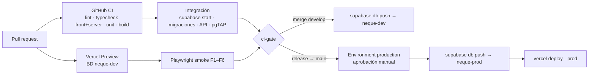

# 04 — Despliegue en Vercel

**Estado:** propuesta (2026-11-02). **No se ha desplegado nada.** Las cifras de límites
de Vercel cambian con los planes: lo marcado _(verificar)_ se confirma en la
documentación vigente al ejecutar la tarea V1.

---

## 1. Compatibilidad del modelo

| Pieza                            | Encaja en Vercel      | Cómo                                                                                                                                                  |
| -------------------------------- | --------------------- | ----------------------------------------------------------------------------------------------------------------------------------------------------- |
| Angular estático                 | Sí, ya se hace        | `outputDirectory: dist/neque/browser`                                                                                                                 |
| BFF                              | Sí, adaptado          | Una función Node en `api/` que exporta el handler de Hono (02 §2). Sin `listen()`, sin estado en memoria                                              |
| Cron (materialización, limpieza) | Parcial               | La materialización es perezosa (02 §6), no depende de cron. Vercel Cron solo para tareas diarias no críticas _(en Hobby, máx. 1 vez/día — verificar)_ |
| Subida de fotos                  | **No por la función** | Body máximo de 4,5 MB por petición: se sube directo a Supabase Storage con URL firmada                                                                |
| WebSockets / realtime            | No                    | No se necesita en el MVP                                                                                                                              |
| Procesos largos                  | No                    | Ningún endpoint debería pasar de ~1 s; `maxDuration` 10 s como techo                                                                                  |

**Incompatibilidad actual detectada (H-04):** el rewrite de `vercel.json`
`/((?!.*\\.).*)` → `/index.html` captura también `/api/...`. Hay que excluir `api/`.

---

## 2. `vercel.json` objetivo

```jsonc
{
  "$schema": "https://openapi.vercel.sh/vercel.json",
  "framework": null,
  "buildCommand": "npm run build:vercel",
  "outputDirectory": "dist/neque/browser",
  "regions": ["gru1"], // misma región que Supabase sa-east-1
  "functions": {
    "api/index.ts": { "maxDuration": 10, "memory": 1024 },
  },
  "rewrites": [
    { "source": "/api/:path*", "destination": "/api" }, // todo /api/* a la única función
    { "source": "/((?!api/|.*\\.).*)", "destination": "/index.html" }, // SPA, sin tocar /api
  ],
  "headers": [
    {
      "source": "/(.*)",
      "headers": [
        {
          "key": "Strict-Transport-Security",
          "value": "max-age=63072000; includeSubDomains; preload",
        },
        { "key": "X-Content-Type-Options", "value": "nosniff" },
        { "key": "Referrer-Policy", "value": "strict-origin-when-cross-origin" },
        { "key": "Permissions-Policy", "value": "camera=(self), geolocation=(), microphone=()" },
        { "key": "X-Frame-Options", "value": "DENY" },
        {
          "key": "Content-Security-Policy",
          "value": "default-src 'self'; script-src 'self'; style-src 'self' 'unsafe-inline'; img-src 'self' data: blob: https://*.supabase.co; connect-src 'self' https://*.supabase.co; font-src 'self'; frame-ancestors 'none'; base-uri 'self'; form-action 'self'",
        },
      ],
    },
    {
      "source": "/api/(.*)",
      "headers": [{ "key": "Cache-Control", "value": "no-store" }],
    },
  ],
}
```

Notas:

- `style-src 'unsafe-inline'` lo exigen los estilos de componentes de Angular; se puede
  endurecer con nonce (`ngCspNonce`) más adelante.
- En la CSP, reemplazar `*.supabase.co` por el host exacto de cada proyecto al cerrar V1.
- La forma exacta del entrypoint (`api/index.ts` + rewrite vs. catch-all) y la
  resolución de alias de TypeScript dentro de la función **se validan en el spike A1**
  antes de construir nada encima. Si los alias no resuelven, `server/` usa imports
  relativos hacia `src/app/domain/**/model`.

---

## 3. Ambientes

| Ambiente Vercel | Disparador                | Supabase                               | Uso               |
| --------------- | ------------------------- | -------------------------------------- | ----------------- |
| Development     | `vercel env pull` + local | Local (`supabase start`) o `neque-dev` | Desarrollo        |
| Preview         | Cada PR / rama            | `neque-dev`                            | QA, E2E, revisión |
| Production      | Release a `main`          | `neque-prod`                           | Usuarios reales   |

### 3.1 Variables

| Variable                   | Ámbito                  | Dev                       | Preview                         | Prod         | Notas                                                                                       |
| -------------------------- | ----------------------- | ------------------------- | ------------------------------- | ------------ | ------------------------------------------------------------------------------------------- |
| `SUPABASE_URL`             | servidor                | local/dev                 | dev                             | prod         |                                                                                             |
| `SUPABASE_PUBLISHABLE_KEY` | servidor                | ✓                         | ✓                               | ✓            | Clave pública nueva (`sb_publishable_…`) o `anon` heredada                                  |
| `SUPABASE_SECRET_KEY`      | servidor, **Sensitive** | ✓                         | ✓                               | ✓            | `sb_secret_…` o `service_role`. Nunca con prefijo público, nunca en `src/`                  |
| `ALLOWED_ORIGINS`          | servidor                | `http://localhost:4200`   | `https://*-<equipo>.vercel.app` | dominio prod | + `capacitor://localhost,https://localhost`                                                 |
| `PUBLIC_APP_URL`           | build                   | `http://localhost:4200`   | `https://$VERCEL_URL`           | dominio prod | Base de los enlaces de invitación                                                           |
| `NEQUE_WEB_ACCESS`         | build                   | — (`ng serve` no bloquea) | `off`                           | `off`        | `off` o `mobile`. `mobile` abre la app a navegadores móviles (presentación); exige redeploy |
| `LOG_LEVEL`                | servidor                | `debug`                   | `info`                          | `info`       |                                                                                             |
| `SEED_*_PASSWORD`          | solo local              | ✓                         | —                               | —            | Nunca en Vercel                                                                             |

`server/config/env.ts` valida todo con zod al cargar el módulo: si falta una variable la
función falla al primer request con un log claro, no a mitad de un flujo.

### 3.2 Variables del front (compile-time)

Angular resuelve `environment` al compilar. Hoy `publicAppUrl` está fijo a
`https://neque.vercel.app`, lo que haría que un Preview genere invitaciones que apuntan a
producción.

Propuesta: script `scripts/write-env.mjs` que corre en `build:vercel` antes de `ng build`
y escribe `src/environments/environment.generated.ts` a partir de `VERCEL_ENV` y
`PUBLIC_APP_URL`:

| Campo          | Web                                                    | Nativo (Capacitor)                                 |
| -------------- | ------------------------------------------------------ | -------------------------------------------------- |
| `apiBaseUrl`   | `/api/v1` (relativo: sirve en Preview y Prod sin CORS) | `https://<dominio-prod>/api/v1` (absoluto)         |
| `publicAppUrl` | `PUBLIC_APP_URL`                                       | dominio prod                                       |
| `dataSource`   | `http`                                                 | `http` (`mock` solo en el build `demo` y en tests) |

Se eliminan `supabaseUrl`, `supabaseAnonKey` y `flowApiUrl` (H-13): el front no habla
con Supabase.

---

## 4. Desarrollo local

```bash
supabase start
```

```bash
npm run dev:api
```

```bash
npm start
```

- `dev:api`: `tsx watch server/dev.ts`, que sirve la misma app Hono con
  `@hono/node-server` en `:3000`.
- `ng serve` con `proxy.conf.json`: `/api` → `http://localhost:3000`. Así el front usa
  `/api/v1` relativo igual que en Vercel.
- `vercel dev` es alternativa, pero con `framework: null` y build propio conviene el
  par anterior (más rápido, recarga de ambos lados).

---

## 5. CI/CD



Reglas:

1. **Orden migración → deploy.** Las migraciones de prod corren en GitHub Actions antes
   del deploy de producción. Para no depender de ese orden, toda migración es
   _expand/contract_: el código viejo funciona con el esquema nuevo.
2. Desactivar el auto-deploy de producción desde la integración Git (`git.deploymentEnabled`
   para `main` en `false`) y desplegar con `vercel deploy --prod` desde el workflow,
   **o** mantener el auto-deploy y aceptar la regla 1 como única garantía. **[DECISIÓN]**
3. Previews siempre contra `neque-dev`. Nunca contra prod.
4. Secretos de CI: `VERCEL_TOKEN`, `SUPABASE_ACCESS_TOKEN`, `SUPABASE_DB_PASSWORD_PROD`,
   solo en el _environment_ `production`.
5. Agregar `gitleaks` (o el secret scanning de GitHub) al CI.

---

## 6. Límites a vigilar _(verificar todos en V1)_

| Límite                                  | Valor de referencia  | Impacto en Ñeque                                              |
| --------------------------------------- | -------------------- | ------------------------------------------------------------- |
| Body de request/response de una función | 4,5 MB               | Fotos por Storage directo (resuelto en diseño)                |
| Duración máxima de función              | Depende del plan     | `maxDuration: 10` como techo propio                           |
| Tamaño de función                       | 250 MB descomprimida | Holgado con Hono + supabase-js                                |
| Cron en Hobby                           | 1 ejecución diaria   | Solo para respaldos/limpieza                                  |
| Uso comercial en Hobby                  | No permitido         | Riesgo R4: el piloto con entrenadores reales puede exigir Pro |
| Retención de logs                       | Corta en Hobby       | Enviar errores a un servicio externo si se necesita historial |

---

## 7. Dominio, HTTPS, monitoreo

- **Dominio propio** (p. ej. `neque.cl`) antes de imprimir QRs reales: los enlaces
  `/i/:token` quedan en manos de los alumnos y no deben depender de `*.vercel.app`.
  HTTPS lo gestiona Vercel automáticamente.
- **Health:** `GET /api/health` (verifica BD) monitoreado cada 5 min desde un servicio
  externo de uptime; objetivo PRD §7: ≥99 % de 07:00 a 22:00 CLT.
- **Logs:** JSON estructurado con `requestId` (cabecera `x-request-id` devuelta al
  cliente para soporte).
- **Errores:** opcional Sentry en front y BFF, con `beforeSend` que elimina PII.
- **Latencia:** registrar `ms` por ruta; objetivo p95 < 200 ms en rutinas y alumnos.
