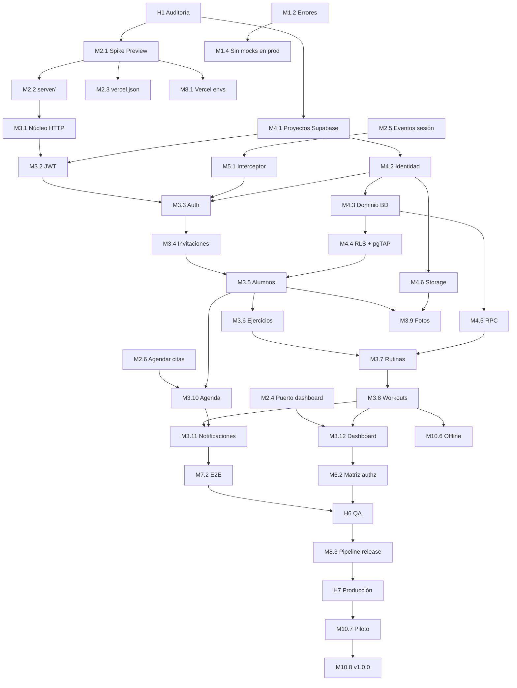

# 05 — Backlog y roadmap hacia producción

**Estado:** propuesta (2026-11-02). Las tareas son **nuevas** (prefijo `NEQ-M`) salvo
donde la columna _HU_ cite una HU original del `BACKLOG.md`.
**Base:** [auditoría integral](../auditoria/2026-11-02-auditoria-integral.md).

Prioridad: **C** crítica · **A** alta · **M** media · **B** baja.
Tamaño: **S** ≤1 día · **M** 2–3 días · **L** ~1 semana · **XL** >1 semana.
Tipo: **F** funcionalidad · **R** refactor · **Bug** · **I** infraestructura · **T** testing · **D** docs.

Regla transversal: cada tarea de BFF (épica 3) incluye **su adapter HTTP en el front y
su política RLS**: se entrega por vertical, no por capa.

---

## Épica M1 — Correcciones y estabilización del frontend

| ID   | Título                                           | Descripción                                                                        | Criterios de aceptación                                                          | Deps | P   | T   | HU   | Tipo       |
| ---- | ------------------------------------------------ | ---------------------------------------------------------------------------------- | -------------------------------------------------------------------------------- | ---- | --- | --- | ---- | ---------- |
| M1.1 | Verificar gates en local y fijar línea base      | `npm ci` y correr lint, typecheck, test:coverage, build:prod                       | Métricas reales registradas en el backlog; si difieren de 2026-09-27, se explica | —    | A   | S   | 0.2  | T          |
| M1.2 | Ampliar `DomainErrorCode`                        | `forbidden`, `validation`, `plan_limit`, `offline` con mensajes en español         | Specs de `app-error.ts`; ninguna página rompe                                    | —    | A   | S   | —    | R          |
| M1.3 | Alinear configuración con PRD §7                 | Umbral 95/85, budget 300/400 kB, quitar `flowApiUrl`                               | `test:coverage` y `build` verdes con los nuevos umbrales                         | M1.1 | M   | S   | 12.1 | R          |
| M1.4 | Excluir mocks y semillas del build de producción | `environment.dataSource` y providers condicionales; build `demo` aparte            | `grep` del bundle prod sin `Entrenador1!` ni `seed`                              | M1.2 | C   | M   | —    | Bug (H-03) |
| M1.5 | Mover `passwordRules` a `domain/auth/model`      | Para que el BFF valide con la misma regla                                          | Front y BFF importan la misma función                                            | —    | M   | S   | —    | R          |
| M1.6 | Actualizar documentos desfasados                 | BACKLOG (0.0.4 mergeada, T-0.1.1), PRD §5 (monolito), `modelo-datos.md` → superado | Sin contradicciones con `git log`                                                | —    | M   | S   | 0.1  | D (H-16)   |

## Épica M2 — Refactorización arquitectónica

| ID   | Título                                    | Descripción                                                                    | Criterios de aceptación                                                                  | Deps | P   | T   | HU   | Tipo       |
| ---- | ----------------------------------------- | ------------------------------------------------------------------------------ | ---------------------------------------------------------------------------------------- | ---- | --- | --- | ---- | ---------- |
| M2.1 | **Spike: `/api/health` en un Preview**    | Función mínima que importa un modelo de `src/app/domain` y responde            | URL de Preview responde 200; la SPA sigue funcionando; resolución de imports documentada | —    | C   | M   | —    | I          |
| M2.2 | Esqueleto `server/` hexagonal             | Carpetas, `tsconfig.server.json`, ESLint `no-restricted-paths`, Jest server    | `tsc -p tsconfig.server.json` y lint verdes en CI                                        | M2.1 | C   | M   | —    | R          |
| M2.3 | Corregir `vercel.json`                    | Rewrites que respetan `/api`, `regions`, `functions`, headers                  | `/api/v1/health` y `/trainer/home` funcionan en Preview                                  | M2.1 | C   | S   | —    | Bug (H-04) |
| M2.4 | Puerto agregado del Inicio del entrenador | `TRAINER_DASHBOARD_PORT`; `TrainerHomeFacade` y `TrainerProfileFacade` lo usan | Una petición por pantalla; specs actualizadas; mock equivalente                          | M1.2 | A   | M   | 9.11 | R (H-05)   |
| M2.5 | Eventos de sesión                         | `AUTH_EVENTS_PORT`; `SessionFacade` limpia y redirige en `sessionExpired`      | Spec: un 401 irrecuperable deja al usuario en `/`                                        | —    | A   | S   | 7.3  | R (H-08)   |
| M2.6 | El entrenador agenda citas                | `SchedulePort.create/update`; UI en la ficha del alumno                        | Cita creada aparece en la agenda del alumno                                              | M2.5 | A   | L   | 8.7  | F (H-07)   |

## Épica M3 — Implementación del BFF

| ID    | Título                                | Descripción                                                                                               | Criterios de aceptación                                                                           | Deps             | P   | T   | HU        | Tipo     |
| ----- | ------------------------------------- | --------------------------------------------------------------------------------------------------------- | ------------------------------------------------------------------------------------------------- | ---------------- | --- | --- | --------- | -------- |
| M3.1  | Núcleo HTTP                           | Hono, `env` con zod, `requestId`, CORS, mapeo de errores (02 §7), logs sin PII                            | Error 500 no filtra detalle; CORS rechaza origen no listado                                       | M2.2             | C   | M   | —         | F        |
| M3.2  | Middleware de autenticación           | JWKS con `jose`, `actor` desde `app_metadata`, `requireRole`                                              | Token alterado/vencido → 401; rol erróneo → 403                                                   | M3.1, M4.1       | C   | M   | 7.3       | F        |
| M3.3  | Endpoints de auth                     | login (+bloqueo), refresh, logout, reset en 3 pasos, cambio de contraseña + `HttpAuthAdapter`             | Los specs del flujo de recuperación pasan contra la API; 5 fallos bloquean 5 min entre instancias | M3.2, M4.2, M5.1 | C   | L   | 7.3, 11.5 | F        |
| M3.4  | Invitaciones                          | resolve, accept, getForStudent, create, revoke + adapter                                                  | CA2: invitación aceptada en otro dispositivo; token de un uso; hash en BD                         | M3.3             | C   | M   | 7.4, 9.5  | F        |
| M3.5  | Alumnos, anamnesis, evaluaciones      | CRUD de §5 + adapters                                                                                     | CA7 parcial: A no ve alumnos de B (test de integración)                                           | M3.4, M4.3       | C   | L   | 9.4–9.7   | F        |
| M3.6  | Entrenadores y catálogo de ejercicios | Perfil, ejercicios públicos/propios + adapters                                                            | Ejercicio propio invisible para otro entrenador                                                   | M3.5             | A   | M   | 9.9, 9.10 | F        |
| M3.7  | Rutinas                               | `save_routine`, `set_routine_assignments`, `remove` + adapter                                             | Asignar a un alumno con rutina previa la cierra en la misma transacción                           | M3.6, M4.5       | C   | L   | 9.8, 13.3 | F        |
| M3.8  | Workouts y materialización            | `ensure_workout_sessions`, start/logSet/skip/complete idempotentes + adapter                              | CA4: carga real registrada se lee desde la API; reintento con mismo `clientOpId` no duplica       | M3.7             | C   | XL  | 8.5, 9.12 | F (H-06) |
| M3.9  | Fotos y avatares                      | URLs firmadas de subida y lectura + subida en dos pasos dentro del adapter                                | Foto de 4 MB sube; URL caduca a los 10 min; otro alumno recibe 404                                | M3.5, M4.6       | A   | M   | 8.6       | F (H-10) |
| M3.10 | Agenda                                | list, confirm, cancel (ambos roles), create                                                               | Cancelar con `other` sin nota → 400                                                               | M3.5, M2.6       | A   | M   | 8.7, 12.3 | F        |
| M3.11 | Notificaciones y eventos              | list, markRead, markAll; emisión en invitación aceptada, salto por dolor, rutina asignada, cita cancelada | Cada evento genera una fila para el destinatario correcto                                         | M3.8, M3.10      | A   | M   | 8.8, 13.5 | F        |
| M3.12 | Dashboard del entrenador              | `GET /trainers/me/dashboard` sobre `trainer_dashboard()`                                                  | CA1: Inicio con datos reales; p95 < 200 ms con 20 alumnos                                         | M2.4, M3.8       | A   | M   | 9.11      | F        |

## Épica M4 — Integración con Supabase

| ID   | Título                                   | Descripción                                                                                        | Criterios de aceptación                                          | Deps             | P   | T   | HU     | Tipo |
| ---- | ---------------------------------------- | -------------------------------------------------------------------------------------------------- | ---------------------------------------------------------------- | ---------------- | --- | --- | ------ | ---- |
| M4.1 | Proyectos y Auth configurados            | `neque-dev`/`neque-prod` en `sa-east-1`, RS256, sign-up off, SMTP propio, plantilla OTP            | Correo de recuperación llega a un correo externo al equipo       | Aprobación de 03 | C   | M   | —      | I    |
| M4.2 | `supabase init` + migración de identidad | Enums, `profiles`, `trainers`, `students`, `invitations`, tickets, `login_attempts`                | `supabase db reset` limpio; RLS habilitado                       | M4.1             | C   | M   | —      | I    |
| M4.3 | Migraciones de dominio                   | Ficha, rutinas, workouts, progreso, agenda, notificaciones, `device_tokens`                        | Tipos generados coinciden con los modelos (test de contrato)     | M4.2             | C   | L   | —      | I    |
| M4.4 | RLS y pruebas pgTAP                      | Helpers `private.*`, políticas de 03 §6, tests de aislamiento                                      | **CA7** verde en CI                                              | M4.3             | C   | L   | —      | T    |
| M4.5 | Funciones transaccionales                | RPC de 03 §7                                                                                       | Tests pgTAP de cada RPC, incluida concurrencia del único parcial | M4.3             | C   | L   | —      | F    |
| M4.6 | Storage                                  | Buckets, límites, MIME, políticas                                                                  | Subida fuera de su carpeta rechazada                             | M4.2             | A   | S   | —      | I    |
| M4.7 | Seeds y alta manual de entrenadores      | Catálogo como migración de referencia; `seed.sql` + `seed-auth.ts`; `create-trainer.sql` + runbook | Dev reproducible en un comando; prod sin datos de prueba         | M4.3             | A   | M   | PRD M1 | I    |
| M4.8 | Respaldo y restauración                  | Dump nocturno cifrado, copia de bucket, restauración mensual                                       | Restauración probada y registrada                                | M4.3             | A   | M   | —      | I    |

## Épica M5 — Autenticación y autorización (front)

| ID   | Título                          | Descripción                                                                                            | Criterios de aceptación                                   | Deps       | P   | T   | HU  | Tipo |
| ---- | ------------------------------- | ------------------------------------------------------------------------------------------------------ | --------------------------------------------------------- | ---------- | --- | --- | --- | ---- |
| M5.1 | Cliente HTTP e interceptor      | `provideHttpClient(withFetch())`, Bearer, refresh _single-flight_, mapeo a `DomainError`               | Dos peticiones con token vencido producen un solo refresh | M2.5       | C   | L   | 10  | F    |
| M5.2 | Almacenamiento de sesión nativo | `@capacitor/preferences` en nativo (sincrónico vía cache al arrancar, como prevé `SessionStoragePort`) | La sesión sobrevive al cierre de la app en iOS            | M5.1       | A   | M   | —   | F    |
| M5.3 | Expiración y logout global      | Logout revoca refresh en servidor; suspensión del alumno invalida acceso                               | Alumno suspendido recibe 401/403 en su siguiente petición | M3.3, M3.5 | A   | S   | 2.8 | F    |

## Épica M6 — Seguridad

| ID   | Título                           | Descripción                                                            | Criterios de aceptación                           | Deps  | P   | T   | HU  | Tipo     |
| ---- | -------------------------------- | ---------------------------------------------------------------------- | ------------------------------------------------- | ----- | --- | --- | --- | -------- |
| M6.1 | Cabeceras de seguridad           | CSP, HSTS, etc. (04 §2)                                                | securityheaders.com ≥ A; la app funciona          | M2.3  | A   | S   | —   | I (H-15) |
| M6.2 | Matriz de autorización probada   | Test por endpoint: ajeno → 404, rol erróneo → 403                      | 100 % de endpoints de 02 §5                       | M3.12 | C   | M   | —   | T        |
| M6.3 | Escaneo de secretos              | `gitleaks` en CI                                                       | Commit con clave falsa bloquea el PR              | —     | M   | S   | —   | I        |
| M6.4 | Consentimiento de datos de salud | Aceptación explícita al aceptar la invitación + política de privacidad | Registro de fecha de consentimiento               | M3.4  | A   | M   | —   | F (R7)   |
| M6.5 | Revisión de logs                 | Sin PII; `Cache-Control: no-store`                                     | Revisión manual de una muestra de logs de Preview | M3.12 | M   | S   | —   | T        |

## Épica M7 — Testing y QA

| ID   | Título                         | Descripción                                                      | Criterios de aceptación               | Deps       | P   | T   | HU  | Tipo     |
| ---- | ------------------------------ | ---------------------------------------------------------------- | ------------------------------------- | ---------- | --- | --- | --- | -------- |
| M7.1 | Job de integración en CI       | `supabase start`, migraciones, tests de API y pgTAP              | `ci-gate` depende del job             | M4.2, M3.1 | C   | M   | —   | T        |
| M7.2 | E2E con Playwright             | F1–F6 del PRD contra Preview, 375×812 y 320×568                  | Smoke en cada PR, completo en release | M3.11      | A   | L   | 6.1 | T (H-14) |
| M7.3 | Checklist de QA de integración | Recorrido manual login → … → logout, ambos roles, en dispositivo | Checklist firmado en `docs/`          | M7.2       | A   | M   | 6.1 | T        |
| M7.4 | Prueba de carga                | 100 entrenadores × 20 alumnos (PRD §7)                           | p95 < 200 ms en rutinas y alumnos     | M3.12      | M   | M   | —   | T        |

## Épica M8 — Integración con Vercel

| ID   | Título                            | Descripción                                              | Criterios de aceptación                                              | Deps       | P   | T   | HU   | Tipo |
| ---- | --------------------------------- | -------------------------------------------------------- | -------------------------------------------------------------------- | ---------- | --- | --- | ---- | ---- |
| M8.1 | Proyecto y variables por ambiente | Región `gru1`, variables de 04 §3.1, límites verificados | Preview usa `neque-dev`, Prod `neque-prod`                           | M2.1, M4.1 | C   | S   | —    | I    |
| M8.2 | Environment generado en build     | `scripts/write-env.mjs` y `build:vercel`                 | Invitación en Preview apunta al Preview                              | M8.1       | A   | S   | 13.5 | I    |
| M8.3 | Pipeline de release               | Migraciones prod con aprobación → deploy prod            | Release de prueba completa sin pasos manuales fuera de la aprobación | M7.1       | A   | M   | 6.3  | I    |
| M8.4 | Dominio propio                    | DNS + HTTPS + `PUBLIC_APP_URL`                           | QR impreso abre el dominio propio                                    | M8.1       | M   | S   | —    | I    |
| M8.5 | Monitoreo                         | Uptime de `/api/health`, logs con `requestId`, (Sentry)  | Alerta recibida al tirar el health en Preview                        | M3.1       | M   | S   | —    | I    |

## Épica M9 — Documentación

| ID   | Título                   | Descripción                                                     | Criterios de aceptación                       | Deps       | P   | T   | HU  | Tipo |
| ---- | ------------------------ | --------------------------------------------------------------- | --------------------------------------------- | ---------- | --- | --- | --- | ---- |
| M9.1 | Guía de desarrollo local | README/CONTRIBUTING: `supabase start`, `dev:api`, `npm start`   | Un clon limpio levanta todo siguiendo la guía | M2.2, M4.2 | A   | S   | —   | D    |
| M9.2 | Contrato de API          | Tabla 02 §5 mantenida o OpenAPI generado desde zod              | Coincide con los endpoints reales (test)      | M3.12      | M   | M   | —   | D    |
| M9.3 | Runbooks                 | Alta de entrenador, restauración, rotación de claves, incidente | Revisados en un simulacro                     | M4.7, M4.8 | M   | S   | —   | D    |
| M9.4 | PRD v2.1                 | §5, §9, §11 y §6 re-verificados (R4)                            | Estados de §6 coinciden con el código         | Hito 5     | M   | S   | —   | D    |

## Épica M10 — Preparación para producción

| ID    | Título                        | Descripción                                                           | Criterios de aceptación                                | Deps         | P   | T   | HU         | Tipo |
| ----- | ----------------------------- | --------------------------------------------------------------------- | ------------------------------------------------------ | ------------ | --- | --- | ---------- | ---- |
| M10.1 | Brechas del PRD sobre el BFF  | Progresión de carga en la ficha, cancelación por entrenador, freemium | Criterios de HU-12.2/12.3/12.4 contra la API           | M3.8, M3.10  | A   | L   | 12.2–12.4  | F    |
| M10.2 | Notas privadas                | HU-12.5 sobre `trainer_notes`                                         | El alumno no puede leerlas (pgTAP)                     | M3.5         | A   | M   | 12.5       | F    |
| M10.3 | Revisar alcance de plantillas | Decidir si HU-12.6 sigue viva tras T-13.3.1                           | Decisión registrada                                    | —            | B   | S   | 12.6       | D    |
| M10.4 | Plataformas nativas firmadas  | `android/`, `ios/`, firma, apuntando a la API de prod                 | APK/IPA instalables; CORS nativo probado               | M8.1         | A   | L   | 6.2, 12.7  | I    |
| M10.5 | Cámara y push                 | HU-12.8 y 12.9 completas con envío desde el BFF                       | Push de prueba abre la pantalla correcta               | M10.4, M3.11 | A   | L   | 12.8, 12.9 | F    |
| M10.6 | Ejecución sin conexión        | HU-12.10 con `clientOpId`                                             | **CA5**: modo avión → series en Supabase al reconectar | M3.8         | A   | XL  | 12.10      | F    |
| M10.7 | Piloto con 2 entrenadores     | Onboarding, soporte, criterios de salida                              | **CA9**: dos semanas de uso                            | Hito 7       | C   | L   | PRD CA9    | F    |
| M10.8 | Release v1.0.0                | Versión, CHANGELOG, tag                                               | Tag publicado con artefactos                           | M10.7        | M   | S   | 6.3        | I    |

---

## Roadmap

### Hitos

| Hito                                      | Contenido                                  | Sale cuando                                                                   |
| ----------------------------------------- | ------------------------------------------ | ----------------------------------------------------------------------------- |
| **H1 · Auditoría y diagnóstico**          | Este conjunto de documentos                | Decisiones **[DECISIÓN]** de 02, 03 y 04 respondidas                          |
| **H2 · Arquitectura monolítica definida** | M1.1, M1.2, M1.4, M2.1–M2.3, M2.5          | Preview con `/api/v1/health` y SPA sin mocks en el bundle                     |
| **H3 · BFF integrado**                    | M3.1, M3.2, M7.1, M8.1                     | Petición autenticada llega al BFF y se rechaza sin token                      |
| **H4 · Supabase conectado**               | M4.1–M4.6, M3.3, M5.1                      | Login real + recuperación con correo real + CA7 en CI                         |
| **H5 · Funcionalidades migradas**         | M3.4–M3.12, M2.4, M2.6, M4.7               | Flujos F1–F6 contra la API en Preview (CA1, CA2, CA4)                         |
| **H6 · QA y estabilización**              | M6.\*, M7.2–M7.4, M10.1, M10.2, M5.2, M5.3 | E2E verde, matriz de autorización completa, p95 medido                        |
| **H7 · Despliegue en Vercel**             | M8.2–M8.5, M4.8, M9.\*, M10.4              | Producción en dominio propio, respaldo probado, apps nativas apuntando a prod |
| **H8 · Validación productiva**            | M10.5–M10.8                                | CA5, CA8, CA9                                                                 |

### Dependencias

### Orden recomendado y paralelismo

1. **Semana 1:** H1 (decisiones) → M2.1 spike y M4.1 proyectos **en paralelo**. Si el
   spike falla, se cambia de estrategia antes de invertir en nada más.
2. **Semana 2:** M2.2, M2.3, M1.2, M1.4, M2.5, M4.2 → **H2**.
3. **Semanas 3–4:** M3.1–M3.3, M5.1, M4.3–M4.5, M7.1 → **H3 + H4**. Auth es la primera
   vertical porque desbloquea todas las demás.
4. **Semanas 5–7:** verticales M3.4 → M3.12 en el orden del grafo, cada una con su
   adapter y su RLS → **H5**.
5. **Semana 8:** **H6**.
6. **Semana 9:** **H7**.
7. **Después:** H8 (piloto mínimo dos semanas → la entrega de diciembre queda justa:
   ver riesgo R1 de la auditoría).

Si el calendario aprieta, lo que se recorta primero es M10.5 (cámara/push) y M10.6
(offline), que el PRD ya admite degradar (R2). Lo que **no** se recorta: M4.4 (RLS),
M6.2 (autorización) y M3.3 (auth real).

---

## Qué falta para "funcional, estable y lista para producción"

| Nivel      | Requisito mínimo                                                                                                    | Tareas    |
| ---------- | ------------------------------------------------------------------------------------------------------------------- | --------- |
| Funcional  | Login real, datos que persisten, flujos F1–F6 contra la API                                                         | H2–H5     |
| Estable    | E2E, matriz de autorización, RLS probado, manejo de 401/red, monitoreo                                              | H6 + M8.5 |
| Producción | Dominio, respaldos probados, SMTP, secretos solo en Vercel, apps nativas firmadas, consentimiento de datos de salud | H7        |
